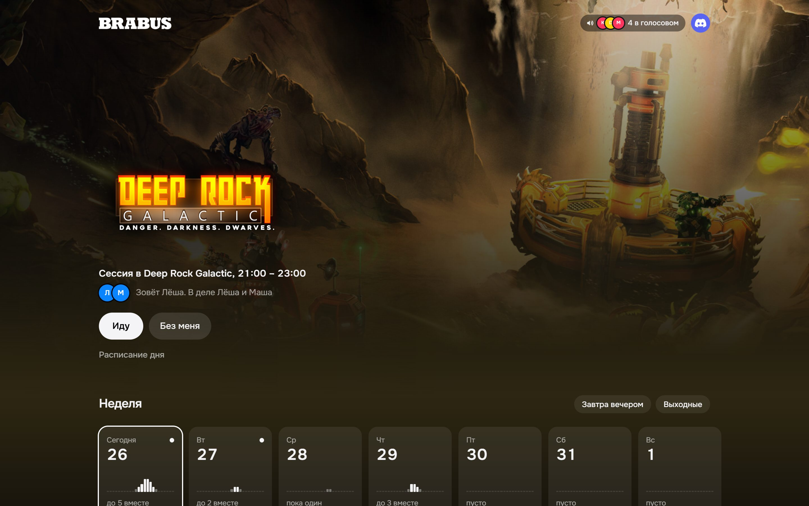
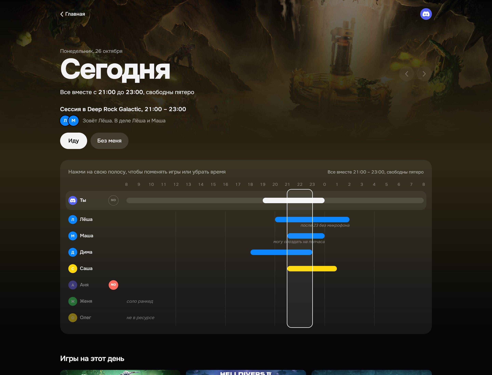
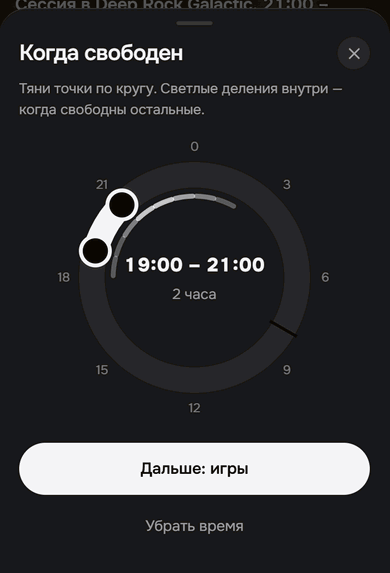
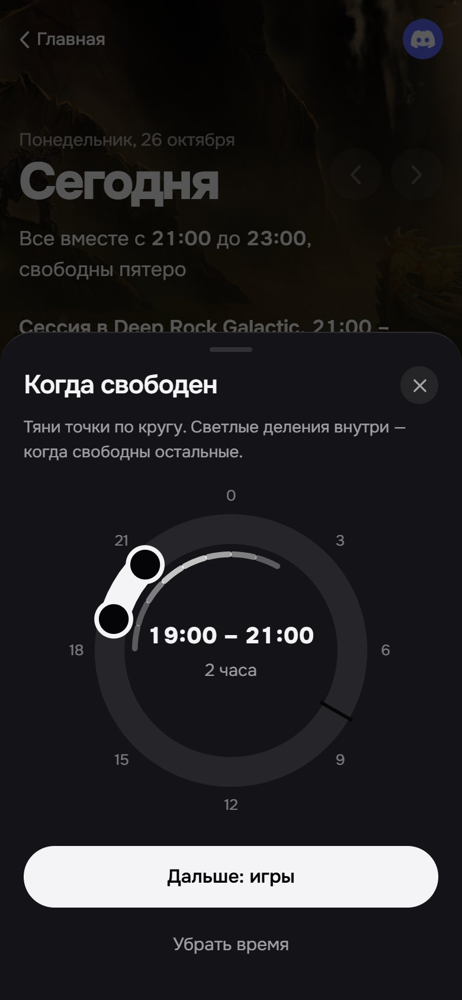

<p align="center">
  
</p>

<h1 align="center">brbs mafia</h1>

<p align="center">
  A Telegram Mini App for a group of friends spread across time zones.<br>
  Everyone marks when they're free and what they want to play; the app finds the time that works for the whole crew.
</p>

<p align="center">
  <a href="https://brbsmafia.vercel.app/demo"><b>Live demo</b></a> ·
  <a href="https://brbsmafia.vercel.app/demo?day">Day timeline demo</a>
</p>

<p align="center">
  
  
  
  
  
  
</p>

<p align="center">
  
</p>

---

## Why

When it's 9 pm for one person, midnight for another and a third is still at work, "let's play tonight" doesn't work. It used to mean a long chat thread: who's free when, what are we playing, is anyone actually coming.

**brbs mafia** handles it differently. Everyone marks their free time on a day timeline in their own local time. The app converts it for everyone else, finds the common window and shows what the crew wants to play. An hour before the game the bot pings each person privately.

The demo runs on sample data. The real app only lets in members of the friends' Telegram group, and its interface is in Russian.

## Features

### Time
- **Day timeline.** Free hours are marked right on it: tap the start, tap the end and see the duration. Everyone else's bars sit alongside, and the common window is highlighted.
- **24-hour dial on phones.** On narrow screens time is picked on a clock face instead of a thin bar: drag two handles, and the inner ring lights up where others are free.
- **Everyone's own clock.** Everything is stored in UTC and shown in the viewer's time zone. Hover over a name to see the friend's local time and how far ahead or behind they are.
- **Gaming day from 08:00 to 08:00.** A late-night session isn't split across two dates.
- **NO.** One button for "can't make it today".
- **Notes.** A short note next to your time, like "no mic after 11pm".
- **The week, Monday to Sunday.** Day tiles with everyone's marks; "today" moves on by itself at 08:00. A day expands out of its tile over the home screen, and you can page between neighbouring days.

<p align="center">
  
</p>

### Games
- **Shared library.** Covers, art and logos come from Steam automatically. Search by name, app ID or store link, including games hidden in some regional stores.
- **Custom art** for non-Steam games: cover, hero, header and logo in Steam's sizes.
- **"Want now" status.** Up to three games, lasts a day, visible to everyone.
- **Games for the day.** Attach up to five games to your time. The most picked one becomes the "game of the day" in the header, and its art tints the whole page.
- **Steam sync.** Everyone links their Steam profile. Games owned by at least two people land on the shelf automatically, and the ones the crew plays most rise to the top.
- **Personal order.** Drag games into your own order; the ones you pick often slowly move up by themselves.

### Sessions
- **One-tap session.** Books the common window and the chosen game; others answer "In" or "Out".
- **One-hour reminder.** The bot messages each person privately: the game, the time in their own zone and who's coming. Buttons in the message let them answer without opening the app. If there's a common window but nobody started a session, the first "In" from a reminder creates one.
- **Evening nudge.** Anyone who hasn't marked the day by 18:00, while others already have, gets one private message with "Mark time" and "NO today" buttons.
- **Discord summary.** One message per day, posted in the morning and edited after every change, plus a "who's in voice now" badge on the home screen.

### Stats
- **Monthly recap:** number of sessions and the game of the month.
- **Best weekday:** when the most people were free together over the last 8 weeks, and from what time.

### Details
- **Telegram-only login.** No passwords or invites: membership in the group is the key, checked with the bot on every login and once a day.
- **Live updates.** When someone marks their time, everyone else's timeline, week and header update instantly.
- **Splash screen.** Eight "party gathering" choreographies made of the crew's avatars, one per crew size.
- **Native Telegram feel.** System Back button, haptics, header colors matching the theme.

<p align="center">
  
  &nbsp;&nbsp;
  
</p>

## How it works

```
Telegram ──initData──▶ /api/tg/auth ──▶ Supabase Auth (session)
   ▲                                          │
   │ reminders, buttons                       ▼
 Bot ◀── /api/tg/remind ◀── pg_cron       Postgres + RLS ──realtime──▶ every open app
   └──▶ /api/tg/webhook (answers)             ▲
                                              │
Steam Web API ──▶ daily sync ─────────────────┘──▶ Discord webhook (daily summary)
```

| Layer | Stack |
|---|---|
| UI | Next.js 16 (App Router, Server Actions), React 19, Tailwind CSS 4, dnd-kit |
| Data | Supabase: Postgres with row-level security, Realtime, Storage for avatars and art |
| Auth | Mini App `initData` signature (HMAC of the bot token) plus a group membership check |
| Background jobs | `pg_cron` + `pg_net` every 10 minutes (reminders), Vercel Cron daily (Discord, Steam, membership) |
| External APIs | Telegram Bot API, Steam Store and Steam Web API, Discord webhooks and server widget |
| Tests | Vitest: time zones, DST, the common-window algorithm |

Everything runs on the free tiers of Vercel and Supabase.

## Project structure

```
src/
  app/            pages, Server Actions and API routes (tg/auth, tg/remind, tg/webhook, cron, steam, discord)
  components/     home, day timeline and dial, sessions, splash screen, Telegram glue
  lib/            time zones, common-window search, Steam, Telegram, Discord, copy
supabase/         migrations in order: schema.sql → 002 … 010
docs/             README images
```

```bash
npm install
npm run dev      # http://localhost:3000/preview shows the app on sample data
npm test
```

<details>
<summary><b>Running your own copy</b></summary>

1. Create a Supabase project and run the files in `supabase/` in order. `005_reminders.sql` is a template: fill in your site URL and `CRON_SECRET`.
2. Create a bot with [@BotFather](https://t.me/BotFather), add a Mini App for it (`/newapp`) and add the bot to your group.
3. Copy `.env.example` to `.env.local` and fill in the Supabase keys, bot token, group ID, Mini App link, site URL, `CRON_SECRET` and `CREW_TIMEZONE`. `STEAM_API_KEY`, `DISCORD_WEBHOOK_URL` and `DISCORD_GUILD_ID` are optional.
4. Deploy to Vercel with the same variables.
5. Point the bot's webhook at `/api/tg/webhook`. The secret is derived from the bot token: see `webhookSecret()` in `src/lib/telegram.ts`.

</details>

---

<p align="center"><sub>Made for friends.</sub></p>
